  

  # Harmonia

  ### The Ultimate Free, High-Fidelity Music Streaming Experience
  **Lossless ALAC (24-bit / 192 kHz) · Zero Subscriptions · Zero Ads · Synced Karaoke Lyrics · Spotify Canvas · Google Cast · Cross-Device Sync**

  

    
    
    
    
    
  

  

    <a href="#-why-harmonia"><b>Why Harmonia?</b></a> •
    <a href="#-benefits-of-the-harmonia-ecosystem"><b>All Benefits</b></a> •
    <a href="#-harmonia-vs-the-giants-in-depth-comparison"><b>Head-to-Head Comparison</b></a> •
    <a href="#-feature-matrix-at-a-glance"><b>Comparison Table</b></a> •
    <a href="#-get-started-in-seconds"><b>Get Started</b></a> •
    <a href="#-fair-use--privacy-disclaimer"><b>Disclaimer</b></a>
  

---

  

---

## 💡 Why Harmonia?

Mainstream streaming platforms charge **$11 to $14 every single month** ($130–$170/year), bombard non-paying listeners with disruptive advertisements, restrict basic mobile functionality (like shuffling and skipping), compress audio down to lossy bitrates, and lock user playlists inside closed, proprietary ecosystems.

**Harmonia breaks this model entirely.**

Harmonia combines a state-of-the-art **mobile audio engine** with a private, self-hostable **cloud sync backend** to give you everything you love about Spotify Premium, Apple Music, and YouTube Music — with **uncompromising audiophile quality, zero fees, zero ads, and total privacy.**

---

## ✨ Benefits of the Harmonia Ecosystem

### 🎧 1. Studio-Grade Audiophile Fidelity (Bit-Perfect ALAC)
* **True Lossless & Hi-Res Audio**: Stream in bit-perfect ALAC up to **24-bit / 192 kHz**, unlocking studio master clarity that exceeds standard streaming quality.
* **Native Android Media3 Engine**: Built with a custom native audio pipeline via `expo-audio` for ultra-low latency, gapless track transitions, and intelligent audio buffer sizing.
* **High-Bitrate Streams**: Enjoy pristine 320 kbps AAC and 256 kbps Opus streams with intelligent network-aware adaptive bitrate switching.
* **Full Background & Lockscreen Playback**: Control your music from your notification bar, lockscreen, or Android Auto with interactive scrub bars and high-resolution album artwork.

### 🌐 2. Dual-Engine Streaming with Instant Failover
* **Direct JioSaavn High-Speed CDN**: Delivers high-bitrate, uncompressed streams with instantaneous buffering.
* **Direct YouTube Music Fallback**: Instantaneous multi-tier resolution. If any track, cover, remix, or live performance is missing, Harmonia automatically resolves it from YouTube Music.
* **Zero Audio Proxying**: Audio streams directly from public CDNs to your device, ensuring maximum speed, minimal latency, and zero server bottlenecks.

### 🎙️ 3. Real-Time Synced Karaoke Lyrics & Multilingual Translation
* **Word-by-Word & Line-by-Line Lyrics**: Powered by LRCLib with fluid karaoke styling and active sung-line typography emphasis.
* **Interactive Tap-to-Seek**: Tap any lyric line in the lyrics view to instantly jump the playhead to that exact syllable.
* **Multilingual Translation & Romanization**: Automatically romanizes non-Latin scripts (Korean, Japanese, Hindi, Punjabi, etc.) and provides instantaneous translation.
* **Integrated Lyric Editor**: Missing lyrics or out of sync? Edit or add custom LRC files directly within the player with instant offline persistence.
* **Luxurious Frosted Glass Blur**: Lyrics float above a gorgeous dynamic frosted glass background blurred directly from your album artwork.

### 🎬 4. Spotify Canvas Loops & Full Music Videos
* **Spotify Canvas Video Loops**: Enjoy looping visual art and video backdrops powered by hardware-accelerated video decoders (`expo-video`).
* **Instant Music Video Mode**: Switch seamlessly from pure audio to official YouTube music videos with a single tap.
* **Smart GPU Power Management**: Built-in Battery Saver mode automatically pauses video decoders when your phone screen dims or when the app is in the background.

### 📡 5. Google Cast & Smart Home Streaming
* **Seamless Chromecast Integration**: Beam your music to Google Nest, Android TVs, smart speakers, and home audio systems.
* **Dedicated Cast Sheet**: Control volume, switch devices, and monitor cast connection health in real time without leaving your queue.
* **Position-Aware Handover**: Disconnect or switch devices without ever losing your playback position or queue history.

### 📴 6. Offline Storage & Local Audio Library
* **One-Tap Encrypted Downloads**: Download your favorite songs, full albums, and playlists for completely offline listening with zero data usage.
* **Local Device Music Scanner**: Harmonia scans your phone’s internal storage and SD card for existing music files (`.flac`, `.mp3`, `.m4a`, `.wav`, `.aac`).
* **Unified Music Experience**: Mix your local files, downloaded tracks, and online streams into unified playlists.
* **Bandwidth Protections**: Toggle Wi-Fi-only downloads and manage local cache limits with a single setting.

### 🎨 7. Deep Personalization & Three Player Stages
* **Dynamic Palette Extraction**: The entire app dynamically adopts the color hues, gradients, and moods of whatever album art is currently playing.
* **3 Distinct Player Stages**:
  * **Classic Stage**: Crisp album artwork presentation, essential transport controls, and high-fidelity format badges.
  * **Expressive Stage**: Ambient color bloom, parallax artwork motion, and expansive gesture surfaces.
  * **Apple Music Stage**: Immersive anchored synced lyrics with ambient blurred background and subtle audio scrubbers.
* **14 Dynamic Launcher Icons**: Match your home screen with customizable app icons (Liquid Glass, Neon, Cyberpunk, AMOLED Black, Pixel, and Retro).

### ☁️ 8. Private Cross-Device Sync & Account Cloud (Harmonia Backend)
* **100% Optional**: No account is ever required. Open the app and start listening immediately.
* **Cross-Device Cloud Sync**: When you link a free account, sync your liked songs, custom playlists, and listening history across multiple phones and tablets in real-time.
* **Personalized Recommendations**: Enjoy lightweight, library-derived recommendations built strictly from your listening taste without corporate tracking algorithms.
* **Rock-Solid Security**: Protected with bcrypt password hashing, rotating SHA-256 refresh tokens, short-lived JWT access tokens, and optional Google or GitHub OAuth.

### 🔒 9. Zero Tracking, Zero Ads, 100% Privacy
* **Zero Telemetry**: No Google Analytics, no Facebook trackers, no crashlytics spyware, and no ad profiling.
* **No Paywalls**: Every single feature — from downloads and lyrics to casting and Hi-Res streaming — is unlocked and free for everyone.

---

## 📊 Harmonia vs. The Giants: In-Depth Comparison

### 🟢 Harmonia vs. Spotify Premium ($11.99 / month)
* **Price**: Spotify charges $143.88 every year. Harmonia gives you the premium experience for **$0.00**.
* **Audio Quality**: Spotify caps playback at 320 kbps lossy Ogg Vorbis and has delayed its HiFi tier for years. Harmonia streams bit-perfect **ALAC up to 24-bit / 192 kHz** and 320 kbps AAC.
* **Free Tier Fairness**: Spotify Free restricts mobile users to shuffle-only mode, limits skips to 6 per hour, and interrupts music with repetitive audio advertisements. Harmonia offers complete on-demand playback, unlimited skips, and zero ads forever.
* **Local Library**: Spotify requires complicated desktop local sync over Wi-Fi. Harmonia automatically scans and plays your phone's local audio files out of the box.
* **Freedom**: No account lock-in, no mandatory login to listen.

### 🔴 Harmonia vs. Apple Music ($10.99 / month)
* **Ecosystem Freedom**: Apple Music is designed primarily for Apple devices and requires an active monthly payment. Harmonia is built phone-first with open access for everyone.
* **Visual Immersion**: Apple Music lacks Spotify Canvas looping videos. Harmonia includes both **Spotify Canvas loops** and **YouTube music videos** side by side.
* **Casting Flexibility**: Apple Music focuses on AirPlay. Harmonia integrates native **Google Cast** for seamless playback across Chromecast, Google Nest, and Android smart TVs.

### 🔴 Harmonia vs. YouTube Music ($13.99 / month)
* **Background Playback**: YouTube Music forces non-paying users to keep their screen turned on and pauses music if the app is minimized. Harmonia provides full, unrestricted background audio and lockscreen playback on every build.
* **Audio Fidelity**: YouTube Music streams at a maximum of 256 kbps Opus/AAC. Harmonia elevates listening with lossless 24-bit / 192 kHz ALAC streams and pristine 320 kbps audio.
* **Interface & Lyrics**: YouTube Music’s lyrics are basic plain text. Harmonia offers word-by-word karaoke, dynamic frosted blur, translations, and interactive tap-to-seek.

### 🟣 Harmonia vs. Other Open-Source Players (ViMusic, Spotube, RiMusic)
* **Dual-Source Reliability**: Most open-source players rely on a single scraper (such as Invidious or piped YouTube scrapers) that breaks frequently. Harmonia features a **dual-engine resolver (JioSaavn + YouTube Music)** with automatic fallback and failover.
* **True Lossless ALAC**: Generic open-source apps are capped at 128–256 kbps YouTube audio. Harmonia delivers studio-quality 24-bit / 192 kHz ALAC.
* **Spotify Canvas & Videos**: Harmonia natively renders Spotify Canvas video loops alongside YouTube music videos with zero lag.
* **Optional Cloud Sync Backend**: While other open-source players store playlists only in a local SQLite file that is lost when switching devices, Harmonia offers an optional, secure cloud backend for effortless multi-device sync.

---

## 📋 Feature Matrix at a Glance

| Feature | Harmonia | Spotify (Free / Premium) | Apple Music | YouTube Music Premium | Standard Open-Source Apps |
| :--- | :---: | :---: | :---: | :---: | :---: |
| **Monthly Subscription** | **$0.00 (Free Forever)** | $0 / $11.99 | $10.99 | $13.99 | $0.00 |
| **Commercial Audio Ads** | ❌ **Zero Ads Always** | Frequent (Free) / None (Prem) | None | None | None |
| **Audio Quality** | **Up to 24-bit / 192 kHz ALAC** | Max 320 kbps Ogg Vorbis | 24-bit / 192 kHz ALAC | Max 256 kbps Opus/AAC | 128 – 256 kbps Opus |
| **On-Demand Track Selection** | ✅ **Full Freedom** | Shuffle-Only (Free) / Full (Prem) | Full | Full | Full |
| **Unlimited Skips** | ✅ **Yes** | 6 / hour (Free) / Unlimited (Prem) | Unlimited | Unlimited | Unlimited |
| **Background & Lockscreen Play** | ✅ **Native Media3** | Yes | Yes | Blocked on Free / Yes on Prem | Yes |
| **Synced Karaoke Lyrics** | ✅ **LRCLib (Word & Line)** | Basic (Gated on Free) | Yes | Line-only | Partial / Plain text |
| **Tap-to-Seek Lyric Sync** | ✅ **Yes** | No | Yes | No | Rare |
| **Lyric Translations & Romanization**| ✅ **Yes** | ❌ No | ❌ No | ❌ No | ❌ No |
| **Spotify Canvas Video Loops** | ✅ **Yes (expo-video)** | Yes | ❌ No | ❌ No | ❌ No |
| **Music Video Mode** | ✅ **Yes (YouTube Mode)** | ❌ No | Limited | Yes | Partial |
| **Google Cast Support** | ✅ **Cast Framework 21.5+** | Yes | AirPlay Focus | Yes | Rare / Buggy |
| **Offline Audio Downloads** | ✅ **Encrypted One-Tap** | Premium Only | Paid Only | Paid Only | Partial |
| **Local File Scanner (Device Storage)**| ✅ **MP3, FLAC, M4A, WAV** | Clunky Desktop Sync | Clunky iTunes Sync | Limited | Partial |
| **Now Playing Stages** | ✅ **Classic, Expressive, Apple** | 1 Layout | 1 Layout | 1 Layout | 1 Layout |
| **Dynamic Palette Theming** | ✅ **Artwork-Adaptive** | Basic Dark | Basic | Basic | Basic |
| **Cross-Device Cloud Sync** | ✅ **Optional Harmonia Backend**| Proprietary Cloud | iCloud | Google Cloud | ❌ None (Local only) |
| **Account Required to Play** | ❌ **No (Instant Guest)** | ✅ Yes | ✅ Yes | ✅ Yes | ❌ No |
| **Telemetry & User Tracking** | ❌ **Zero Tracking** | Extensive Tracking | Extensive Tracking | Extensive Tracking | ❌ None |

---

## 📲 Get Started in Seconds

Getting Harmonia on your device takes less than 60 seconds:

1. **Download the Latest APK**:
   Grab the latest verified APK directly from the [Releases Page](https://github.com/shreeharsh-patil/Harmonia/releases/latest/download/Harmonia-mobile.apk) or visit [listenharmonia.vercel.app](https://listenharmonia.vercel.app).
2. **Install on Android**:
   Tap the downloaded `.apk` file. If prompted, toggle *“Allow from this source”* in your device settings.
3. **Start Listening**:
   Open Harmonia and enjoy unlimited, high-fidelity music immediately. No sign-up, no credit card, and no setup required.

---

## 🛡️ Fair Use & Privacy Disclaimer

* Harmonia is a personal, source-available, non-commercial software project created for educational and personal enjoyment.
* All online music streaming is resolved directly from publicly accessible third-party providers (JioSaavn and YouTube Music) and public lyric databases (LRCLib).
* **Harmonia does not host, store, or distribute copyrighted audio files on its own servers.**
* **Harmonia does not bypass DRM or reverse-engineer Spotify's proprietary DRM audio streams.** All Spotify Canvas and metadata connections utilize public identifiers.
* Harmonia respects user privacy: zero personal data or listening telemetry is collected or sold.

---

  Crafted with passion for music lovers and audiophiles worldwide. 
  Harmonia is developed by <a href="https://github.com/shreeharsh-patil">Shreeharsh Patil</a>.

